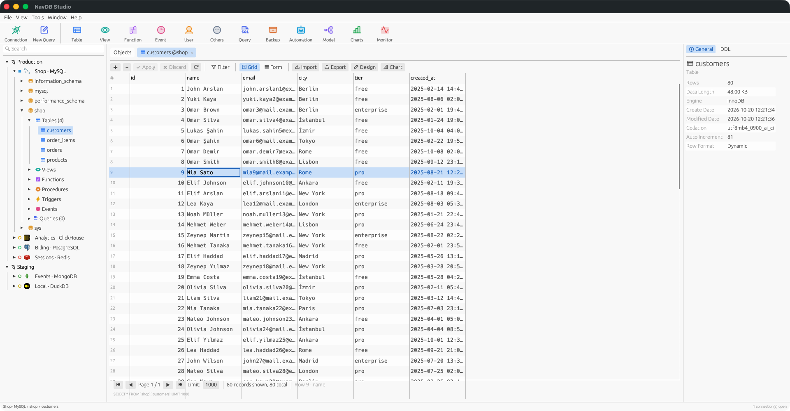
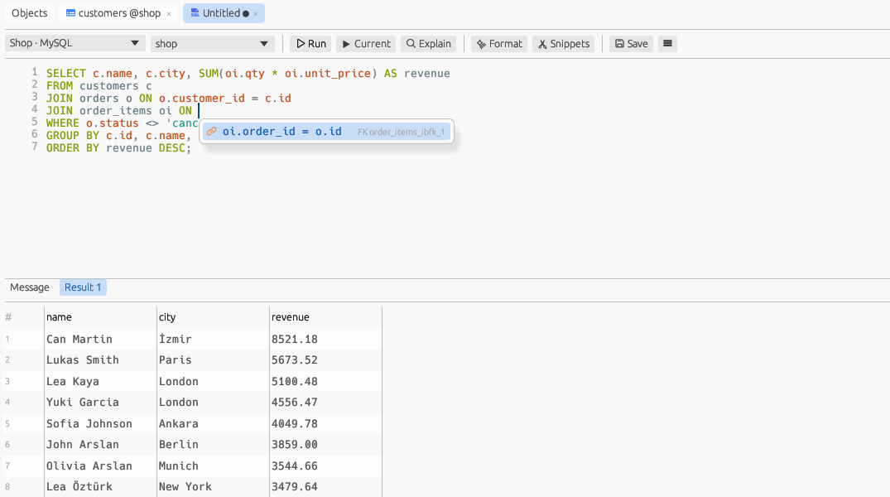
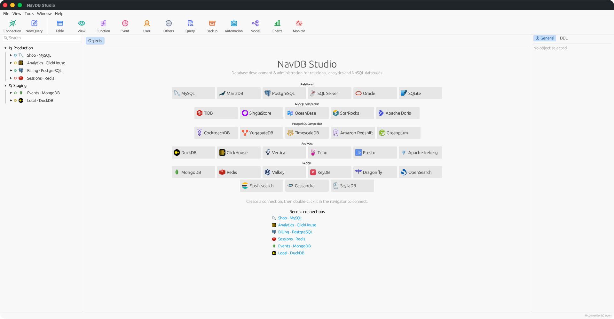

<div align="center">


# NavDB Studio

**A fast, native database GUI for 31 database engines — free and open source.**

A complete database workbench, written from scratch in Rust. One app for MySQL, PostgreSQL, SQLite, SQL Server, Oracle, MongoDB, Redis, ClickHouse, DuckDB, Cassandra, Elasticsearch and many more.

[](https://github.com/alicankuklaci/navdb-studio/actions/workflows/ci.yml)
[](https://github.com/alicankuklaci/navdb-studio/releases/latest)
[](https://github.com/alicankuklaci/navdb-studio/releases)
[](#license)


**English** · [Türkçe](README.tr.md)

[**Download**](#download) · [Features](#features) · [Supported databases](#supported-databases) · [Build from source](#build-from-source) · [Contributing](#contributing)



</div>

---

## Why NavDB Studio?

- **One tool, 31 engines.** Relational, analytical, document, key-value, search and wide-column databases share one navigator, one SQL editor and one data grid.
- **Native and lightweight.** A single self-contained binary built with Rust and [egui](https://github.com/emilk/egui) — no Electron, no JVM, no runtime to install.
- **The whole workflow in one app.** Table designer, data transfer, structure and data sync, ER diagrams, charts and automation, plus extras such as context-aware autocomplete, DuckDB and lakehouse engines.
- **Free and open source.** No license keys, no trial, no telemetry. Dual-licensed MIT / Apache-2.0.
- **Cross-platform.** Windows, macOS (Apple Silicon and Intel) and Linux (x64 and arm64).

## Download

Prebuilt binaries for every release are on the [**Releases page**](https://github.com/alicankuklaci/navdb-studio/releases/latest).

| Platform | Download | Notes |
|---|---|---|
| **Windows** 10/11 (x64) | [NavDB-Studio-windows-x64.zip](https://github.com/alicankuklaci/navdb-studio/releases/latest/download/NavDB-Studio-windows-x64.zip) | Unzip and run `NavDB Studio.exe` |
| **macOS** Apple Silicon | [NavDB-Studio-macos-arm64.dmg](https://github.com/alicankuklaci/navdb-studio/releases/latest/download/NavDB-Studio-macos-arm64.dmg) | macOS 11 or later |
| **macOS** Intel | [NavDB-Studio-macos-x64.dmg](https://github.com/alicankuklaci/navdb-studio/releases/latest/download/NavDB-Studio-macos-x64.dmg) | macOS 11 or later |
| **Linux** x64 — Debian/Ubuntu | [NavDB-Studio-linux-x64.deb](https://github.com/alicankuklaci/navdb-studio/releases/latest/download/NavDB-Studio-linux-x64.deb) | `sudo apt install ./NavDB-Studio-linux-x64.deb` |
| **Linux** x64 — any distro | [NavDB-Studio-linux-x64.tar.gz](https://github.com/alicankuklaci/navdb-studio/releases/latest/download/NavDB-Studio-linux-x64.tar.gz) | glibc 2.35+ (Ubuntu 22.04, Debian 12, Fedora 36 or newer) |
| **Linux** arm64 | [.deb](https://github.com/alicankuklaci/navdb-studio/releases/latest/download/NavDB-Studio-linux-arm64.deb) · [.tar.gz](https://github.com/alicankuklaci/navdb-studio/releases/latest/download/NavDB-Studio-linux-arm64.tar.gz) | Raspberry Pi 4/5, ARM servers |

Each release also ships a `SHA256SUMS.txt` file for verifying downloads.

> [!IMPORTANT]
> **First launch on macOS:** the app is not yet notarized by Apple, so macOS shows *"Apple could not verify 'NavDB Studio' is free of malware…"*. This is expected; the build is produced from this repository by [GitHub Actions](https://github.com/alicankuklaci/navdb-studio/actions/workflows/release.yml). To open it once:
>
> 1. Drag *NavDB Studio* from the `.dmg` to *Applications* and try to open it. Click **Done** in the warning.
> 2. Open **System Settings → Privacy & Security**, scroll down to *"NavDB Studio" was blocked…* and click **Open Anyway**.
>
> Or run this once in Terminal: `xattr -dr com.apple.quarantine "/Applications/NavDB Studio.app"`
>
> **Windows:** in the SmartScreen dialog click **More info → Run anyway**. **Linux:** no extra step is needed.

## Features

<table>
<tr>
<td width="50%" valign="top">

### Explore and edit data
- Navigator tree: connections → databases → schemas → tables, views, functions, procedures, triggers, events, sequences, indexes
- Data grid with paging, inline editing, insert and delete, and transactional **Apply / Discard**
- Visual filter builder, raw `WHERE`, multi-column sort, form view, cell editor for large text and JSON
- Connection groups and colors, read-only connections, SSH tunnels, SSL/TLS

</td>
<td width="50%" valign="top">

### SQL editor
- Syntax highlighting, multiple result tabs, `EXPLAIN`, beautify and minify
- **Context-aware autocomplete:** tables after `FROM`/`JOIN`, columns of aliased tables (`o.` → columns of `orders`), CTE and subquery columns, database and schema qualifiers, dialect functions with signatures
- **JOIN conditions:** type `ON` and get a ready condition from foreign keys, or from `user_id = id` naming when none are declared
- **Signature hints:** the parameter being typed is highlighted inside a function call
- **Hover info:** a table's columns, a column's type and the key it references, a function's signature
- Snippets, saved queries, query history log
- Run the statement under the cursor, a selection, or a whole SQL file

</td>
</tr>
<tr>
<td valign="top">

### Design
- Table designer: columns, indexes, foreign keys, checks and triggers, with a live **SQL preview**
- Designers for views, functions, procedures, triggers, events and sequences
- **ER model:** reverse-engineer a schema into a diagram and export it as SVG or SQL
- User and privilege management

</td>
<td valign="top">

### Move and compare data
- Import: CSV, TSV, JSON, XML
- Export: CSV, TSV, TXT, JSON, XML, HTML, Markdown, SQL, Excel
- **Data Transfer** between connections, including across different engines
- **Structure Sync** and **Data Sync**, with a reviewable script
- Dump to SQL, backup and restore, test-data generation

</td>
</tr>
<tr>
<td valign="top">

### Monitor and automate
- Server monitor: processes, variables, status
- Console, *Find in Database*
- **Automation:** run queries, backups and exports on an interval

</td>
<td valign="top">

### NoSQL and analytics
- Redis key browser and editor (strings, hashes, lists, sets, sorted sets, TTL)
- MongoDB collections and documents
- Charts and dashboards built from query results
- DuckDB, ClickHouse, Trino/Presto and Iceberg for analytics workloads

</td>
</tr>
</table>

<div align="center">

</div>

## Supported databases

<div align="center">

</div>

| Family | Engines |
|---|---|
| **MySQL protocol** | MySQL · MariaDB · TiDB · SingleStore · OceanBase · StarRocks · Apache Doris |
| **PostgreSQL protocol** | PostgreSQL · CockroachDB · YugabyteDB · TimescaleDB · Amazon Redshift · Greenplum |
| **Other relational** | SQLite · Microsoft SQL Server · Oracle¹ · Vertica |
| **Analytics / lakehouse** | DuckDB · ClickHouse · Trino · Presto · Apache Iceberg |
| **Document** | MongoDB |
| **Key-value** | Redis · Valkey · KeyDB · Dragonfly |
| **Search** | Elasticsearch · OpenSearch |
| **Wide-column** | Apache Cassandra · ScyllaDB |

¹ Oracle connections need [Oracle Instant Client](https://www.oracle.com/database/technologies/instant-client.html) on `PATH` (Windows), `DYLD_LIBRARY_PATH` (macOS) or `LD_LIBRARY_PATH` (Linux). The rest of the app works without it.

## Build from source

You need the stable Rust toolchain from [rustup.rs](https://rustup.rs).

```bash
git clone https://github.com/alicankuklaci/navdb-studio.git
cd navdb-studio
cargo run --release -p navdb-app        # binary: target/release/navdb
```

| OS | Additional prerequisites |
|---|---|
| Windows | Visual Studio Build Tools 2019+ with the *Desktop development with C++* workload |
| macOS | Xcode Command Line Tools (`xcode-select --install`) |
| Linux | `build-essential pkg-config libssl-dev libxkbcommon-dev libwayland-dev libgtk-3-dev` (Debian/Ubuntu package names) |

Packaging scripts:

```bash
scripts/bundle-macos.sh target/release/navdb dist          # → dist/NavDB Studio.app
scripts/package-linux.sh target/release/navdb dist 0.1.1   # → .tar.gz + .deb
```

Pushing a `v*` tag runs [`.github/workflows/release.yml`](.github/workflows/release.yml), which builds every platform and publishes a GitHub Release.

### Tests

```bash
cargo test --workspace                                               # unit tests
NAVDB_LIVE=1 cargo test -p navdb-core --test live -- --test-threads=1   # against live servers
```

### Configuration

Connections, preferences, snippets and history live in:

| OS | Location |
|---|---|
| Windows | `%APPDATA%\navdb-studio` |
| macOS | `~/Library/Application Support/navdb-studio` |
| Linux | `~/.config/navdb-studio` |

Set `NAVDB_DATA_DIR` to use a different folder, for example a portable install or an isolated test profile. Passwords are only stored when *Save password* is enabled, and the file is created with owner-only permissions on Unix.

## Architecture

```
crates/navdb-core   GUI-free library: drivers, dialects, SQL tooling, import/export, sync (unit tested)
crates/navdb-app    egui/eframe desktop application (binary: navdb)
```

Each connection runs on its own worker thread, so the UI never blocks on the network. See [docs/ARCHITECTURE.md](docs/ARCHITECTURE.md) for details.

## Contributing

Bug reports, feature requests and pull requests are welcome.

1. Open an [issue](https://github.com/alicankuklaci/navdb-studio/issues) describing the bug or feature.
2. Fork the repository and create a branch.
3. Run `cargo test --workspace` and `cargo clippy --workspace` before opening a pull request.

New database drivers implement the `Driver` trait in `crates/navdb-core/src/driver/`. Existing drivers are good templates.

## License

Licensed under either of

- Apache License, Version 2.0 ([LICENSE-APACHE](LICENSE-APACHE))
- MIT license ([LICENSE-MIT](LICENSE-MIT))

at your option. Unless you explicitly state otherwise, any contribution you intentionally submit for inclusion in this project is dual-licensed as above, without any additional terms or conditions.

---

<sub>NavDB Studio is an independent project. Database and product names and logos are trademarks of their respective owners, used here only to identify the engines NavDB Studio connects to.</sub>
